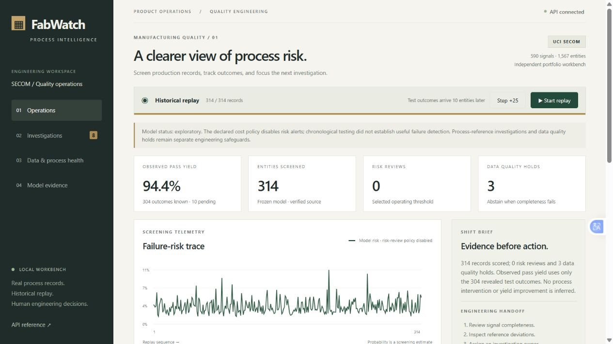
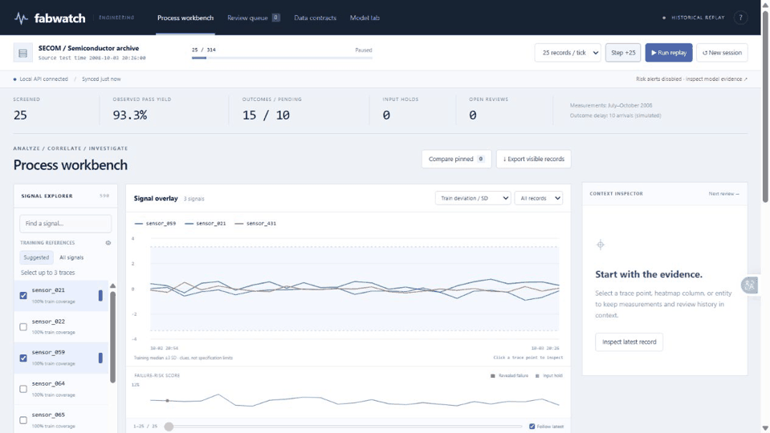
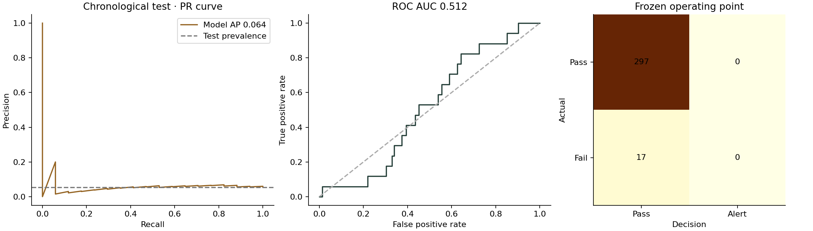
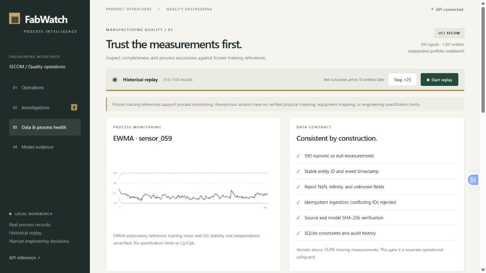

# FabWatch

**A semiconductor quality workbench connecting process data, failure-risk analysis, and engineering investigation.**


Manufacturing engineers need to connect incomplete process signals with test outcomes, consistent KPIs, and accountable follow-up. FabWatch implements that workflow with real public semiconductor records, a local ingestion API, frozen statistical/ML pipelines, a SQL warehouse, and an engineering dashboard.

**The engineering workflow works; useful production failure prediction is not established.** The initial chronological model had weak ranking and selected no risk alerts. A subsequent exploratory challenger improved ranking on the already-inspected test period, but is not promoted or presented as independently confirmed. The evidence and limitations are visible throughout the project.



## Watch it work

[**Play the captioned demonstration (MP4)**](docs/media/fabwatch-demo.mp4) · [Video narration / transcript](docs/DEMO.md) · [Architecture](docs/ARCHITECTURE.md) · [Complete project handoff](docs/PROJECT_HANDOFF.md)



The walkthrough is assembled from actual browser captures of the running local application. It shows historical replay, delayed outcomes, engineering assignment, process health, and model evidence. The data is real; arrival timing and the ten-record outcome delay are demonstration mechanics. There is no live factory connection.

## Demonstrated capabilities

| Engineering need | Implementation | Evidence |
|---|---|---|
| Analyze engineering data | 1,567 entities, 590 anonymous sensor columns, 104 failures | Source checksums; schema and label validation |
| Predict/detect failure risk | Four original classifiers, a pass-only anomaly baseline, seven exploratory challengers | Time-ordered partitions, AP/ROC/Brier, explicit error costs |
| Automate analysis/reporting | Reproducible training, figures, CSVs, model and split manifests | `reports/` and GitHub Actions workflow |
| Support investigation | Training-associated reference deviations, case owner/status/notes | Per-entity evidence and audit trail |
| Track yield | Observed pass fraction from revealed test outcomes | SQL view and operational dashboard; pending outcomes excluded |
| Standardize data/KPIs | Strict JSON contract, normalized SQL tables, documented KPI definitions | SQLite constraints, idempotency, conflict rejection |
| Ensure quality | Missingness gate, nonfinite-value rejection, fingerprints | Three quality holds in held-out replay |
| Translate data into action | Investigation queue and documented handoff | Five exploratory process excursions plus three quality holds |
| Bridge engineering and IT | FastAPI ingress, SQL views, CSV, example Power Query | API docs and BI/statistical-tool handoff guide |

The dataset is small and old. Neither industrial scale nor factory deployment is claimed. JMP, Minitab, and Power BI exports/examples are supplied, but proprietary-tool execution is not claimed. No project can substitute for a degree, employment history, language proficiency, or industrial collaboration experience.

## Run in a few commands

Python 3.12+ recommended. Run from the repository root:

```bash
python -m venv .venv
# Activate: .venv\Scripts\activate (Windows)
# Activate: source .venv/bin/activate (Linux/macOS)
pip install -r requirements.txt
python -m fabwatch.train
python -m uvicorn fabwatch.api:create_app --factory --host 127.0.0.1 --port 8768
```

Open **http://127.0.0.1:8768**, then choose **Start replay**. Dataset download and SHA-256 verification are automatic. No Node build, remote chart CDN, API key, or LLM is required. Use one Uvicorn worker. Interactive API schema: **http://127.0.0.1:8768/docs**.

```bash
python -m pytest -q
python -m scripts.verify_replay
python -m scripts.challenger_study
```

Alternatively: `docker compose up --build`, then open http://127.0.0.1:8000. Docker configuration is supplied; Docker execution was not verified in the local run.

## Results that can be inspected

### Original frozen model

Chronological train/calibration/policy/test sizes: **783 / 235 / 235 / 314**. Test set: **17 failures**, a 5.414% prevalence. Equal timestamps stay together. Imputation, selection, and reference statistics fit only the earliest training partition. The original model and threshold remain frozen for serving.

| Metric | Result |
|---|---:|
| Selected original model | Histogram gradient boosting, sigmoid calibrated |
| Test average precision | 0.06359 |
| Constant-score AP / test prevalence | 0.05414 |
| ROC AUC | 0.51238 |
| Brier score | 0.05182 |
| Model-triggered alerts at selected policy | 0 |
| Missed failures | 17 of 17 |
| Hypothetical cost / 100 entities | 54.14; same as pass-all |
| Warm single-row pipeline p95 | 5.16 ms on measured local CPU |

The cost policy (missed failure: 10 units, false review: 1 unit) selected a threshold above 1, disabling model risk alerts. **This is not successful failure detection.** Pipeline latency excludes HTTP, SQL, and explanations, and does not establish production throughput. Day-block bootstrap AP interval: **[0.02356, 0.12109]**, from 500 resamples.

### Exploratory challenger study

Seven additional candidates were selected using original development data only; the full-signal random forest had the highest policy AP. On the **previously inspected** test period it obtained AP **0.11061**, ROC AUC **0.66271**, 4/17 detected failures, and 30 false reviews. Hypothetical cost was **50.96 / 100 entities**. This is exploratory evidence requiring new future/site validation. It does not overwrite the original model or justify a claim of validated cost reduction.

### Operational verification

- **314** historical entities replayed; **304** revealed outcomes, **10** pending by design.
- **3** missingness abstentions; **5** reference excursions; **8** investigation entries.
- The five reference excursions corresponded to revealed passing entities: they are **not demonstrated failure detections**.
- **314** per-entity evidence endpoints reconciled.
- **29** local automated tests passed, covering temporal separation, train-only preprocessing, frozen prediction parity, invalid inputs, idempotency, delayed labels, restart recovery, SQL exports, safe CSV notes, and full replay.



## Explore the interface

| View | What an engineer can inspect |
|---|---|
| Operations | Revealed-outcome yield, pending outcomes, risk trace, entity ledger |
| Investigations | Review reasons, outcomes, ownership, status, evidence notes |
| Data & process health | Signal completeness, missingness contract, EWMA reference trace |
| Model evidence | Original candidate selection, time partitions, errors and limitations |



## Evidence and documentation

- [Methods, validation, and limitations](docs/METHODS.md)
- [Research papers, dataset attribution, and design references](docs/RESEARCH.md)
- [Architecture, API, and run instructions](docs/ARCHITECTURE.md)
- [KPI dictionary, Power BI/JMP/Minitab handoff](docs/BI_AND_STATISTICS.md)
- [Full project description and résumé handoff](docs/PROJECT_HANDOFF.md)
- [Machine-readable original metrics](reports/metrics.json)
- [Exploratory challenger results](reports/challenger_study.json)
- [Operational verification](reports/verification.json)
- [All held-out predictions](reports/test_predictions.csv)
- [Sample SQL KPI export](reports/sample_kpis.csv)
- [Split provenance](reports/split_manifest.csv)
- [Signal-quality audit](reports/sensor_quality.csv)

## Data and license

SECOM: **Michael McCann and Adrian Johnston (2008)**, UCI Machine Learning Repository, [DOI 10.24432/C54305](https://doi.org/10.24432/C54305), **CC BY 4.0**. The released matrix has 590 sensor columns; the UCI catalog reports 591 features. Sensor semantics and physical units are unavailable. Measurements cannot establish causal root causes or guaranteed pre-test lead time.

Application code: MIT. This is an independent portfolio project, not a Coherent product or an industrial deployment. Public research and interface references are listed in [RESEARCH.md](docs/RESEARCH.md).
