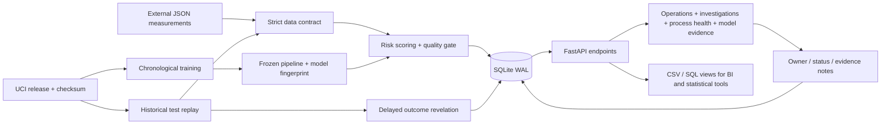

# System design



## Boundaries

The FastAPI app factory validates the frozen artifact before readiness. Model fitting occurs offline; replay never updates weights or transformation statistics. Source records are retained on disk, and only replayed/ingested records enter the operational warehouse. `outcomes` does not populate until synthetic label delay expires. Source timestamps are kept separate from audit wall-clock timestamps.

`entities`, `predictions`, `outcomes`, `investigations`, and `audit` have primary keys and foreign-key constraints. Transactions protect entity/prediction/queue creation. Replay stepping is serialized within one process. SQLite WAL supports dashboard readers. Restart reconstructs the replay checkpoint and reconciles interrupted outcome revelation. Run one Uvicorn worker; this local architecture has no distributed replay coordinator.

The JSON endpoint supports new records from an external process. API validation rejects nonfinite values, unknown fields, labels, malformed IDs, and wrong sensor count. Replay is a demonstrator of continuous ingestion, not a live MES, PLC, or fab connection. Arrival rate is controlled by the browser; it is not factory throughput.

## Run locally

```bash
python -m venv .venv
# Windows: .venv\Scripts\activate
# Linux/macOS: source .venv/bin/activate
pip install -r requirements.txt
python -m fabwatch.train
python -m uvicorn fabwatch.api:create_app --factory --host 127.0.0.1 --port 8768
```

Open `http://127.0.0.1:8768`. The Python workflow requires no Node build or CDN. Dataset download occurs automatically if absent and is verified against `data/manifest.json`. The evaluation plot is distributed with the interface; the training report is authoritative if reproducing on another platform.

To start an independent replay without deleting an existing database:

```powershell
$env:FABWATCH_DB = 'runtime/new-session.db'
python -m uvicorn fabwatch.api:create_app --factory --host 127.0.0.1 --port 8769
```

Or `docker compose up --build`, then open `http://127.0.0.1:8000`. The compose port binds localhost. Docker build/runtime configuration is provided; check `reports/verification.json` for what was actually executed.

## API

| Endpoint | Purpose |
|---|---|
| GET `/api/health` | Readiness and frozen fingerprint |
| POST `/api/predict` | Validate, score, and persist a new entity |
| POST `/api/replay/step?count=25` | Advance 1-50 source records |
| GET `/api/overview` | Entity ledger, observed KPIs, replay state |
| GET `/api/investigations` | Queue and revealed outcomes |
| GET `/api/entity/{id}` | Reference deviations and audit history |
| PATCH `/api/investigations/{id}` | Assign owner, status, note |
| GET `/api/quality` | Signal audit and EWMA |
| GET `/api/model` | Full offline experiment evidence |
| GET `/api/signals` | Searchable training-reference sensor catalog |
| GET `/api/analysis?signals=sensor_059,sensor_021` | Ingested-only measurements and EWMA for selected sensors |
| POST `/api/investigations/{id}` | Idempotent manual engineering review creation |
| POST `/api/replay/new` | Start a separate warehouse while preserving the current file |
| GET `/api/replay/sessions` | List available local replay warehouses |
| POST `/api/replay/select` | Restore a named preserved warehouse and checkpoint |
| GET `/api/export/kpis` | Daily warehouse KPIs CSV |
| GET `/api/export/investigations` | Queue CSV |
| GET `/api/export/audit` | Audit CSV |

Interactive request schemas: `/docs`. Example local ingress:

```python
import requests
payload = {
    'entity_id': 'sensor-contract-demo-1',
    'timestamp': '2026-10-23T12:00:00',
    'sensors': [None] * 590,
}
# Deliberately incomplete contract example; creates an abstention, not a production measurement.
print(requests.post('http://127.0.0.1:8768/api/predict', json=payload).json())
```

## Local demonstration scope

No authentication, RBAC, multi-tenancy, or remote exposure is configured. Bind localhost. A real deployment requires identity, authorization, HTTPS, backup/retention, source availability contracts, and an approved model-monitoring and human review process. The app never writes process setpoints or releases products. Input errors omit raw request data, and the browser escapes user notes before display.

## Workbench interaction boundaries

Analysis responses contain only ingested records and already revealed outcomes. Catalog references use training data. EWMA uses the returned chronological sequence with training-mean initialization; the current application fetches up to 1,000 operational records. The fingerprint shows the latest 80 entities in the selected window. The normalized trace viewport is capped at 12 SD; inspector bars are capped at 6 SD while numeric evidence retains its own documented bounds.

Replay sessions are local warehouses shared by the running single-worker service. New-session creation preserves the prior file; session selection validates known IDs and reconstructs a contiguous checkpoint. The starting database remains controlled by FABWATCH_DB after a process restart; preserved session files can then be selected in the UI. This is not authenticated multi-user session isolation.
